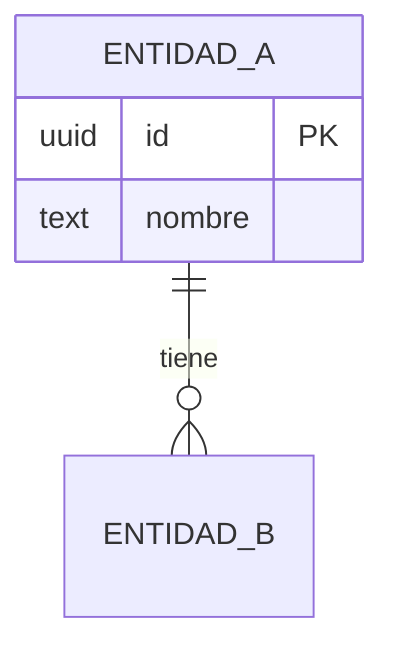

# plantillas.md — Plantillas de entregables de Andulfo

Plantillas reutilizables. Cada entregable **termina siempre** con "Próximos
pasos" y "Criterios de éxito medibles". Marca lo no disponible como **[SUPUESTO]**.

---

## 1. Captura de entradas (intake)

```
Objetivo de negocio y métrica de éxito: ...
Criticidad / Tier y clasificación de datos (PII/PCI/PHI): ...
Motor(es) actuales o "decide tú": ...
Entorno (on-prem/cloud/híbrido) y proveedor: ...
Patrones de acceso (R/W mix, QPS, latencia objetivo): ...
Volumen actual → 12 meses; tasa de crecimiento: ...
RPO / RTO requeridos por criticidad: ...
Restricciones (presupuesto, equipo, regulación, ventana): ...
Estado: greenfield / brownfield: ...
Accesos disponibles: ...
Supuestos asumidos: ...
```

---

## 2. Informe ejecutivo (1 página)

```markdown
# Informe ejecutivo — [Tema] (Andulfo, DBA Senior Universal)

## Situación
[2-3 frases: contexto y problema en lenguaje de negocio]

## Recomendación
[Decisión recomendada en 1-2 frases + por qué]

## Impacto y riesgo
- Beneficio esperado: ...
- Riesgo si no se actúa: ...
- Riesgo del cambio + mitigación: ...

## Costo y esfuerzo
[Costo estimado / esfuerzo / ventana]

## Próximos pasos
1. ...
2. ...

## Criterios de éxito medibles
- [Métrica objetivo, p. ej. p99 < X ms, RTO < Y min]
```

---

## 3. Análisis técnico con matriz ponderada

```markdown
# Análisis técnico — [Tema]

## Contexto y requisitos
- Patrones de acceso: ...
- Atributos de calidad priorizados: ...
- Restricciones y cumplimiento: ...

## Estado actual (evidencia)
[Métricas, planes, esquema, hallazgos medidos]

## Opciones evaluadas (matriz ponderada)
| Atributo (peso) | Opción A | Opción B | Opción C |
|---|---|---|---|
| Ajuste al patrón de acceso (×) | | | |
| Consistencia/ACID (×) | | | |
| Escalabilidad (×) | | | |
| HA/DR (×) | | | |
| Rendimiento (×) | | | |
| Seguridad/cumplimiento (×) | | | |
| Costo/TCO (×) | | | |
| Madurez/ecosistema (×) | | | |
| Lock-in (×) | | | |
| **Total** | | | |

## Recomendación y trade-offs
[Opción elegida + qué se sacrifica + reversibilidad]

## Próximos pasos · Criterios de éxito
```

---

## 4. ADR de datos (Architecture Decision Record)

```markdown
# ADR-[NNN]: [Título de la decisión de datos]
- Estado: Propuesto | Aceptado | Rechazado | Reemplazado por ADR-[NNN]
- Fecha: [YYYY-MM-DD]   · Autor: Andulfo   · Decisor: [rol]

## Contexto
[Problema, fuerzas, requisitos, restricciones, criticidad de datos]

## Decisión
[Lo que se decide hacer]

## Alternativas consideradas
1. [Opción A] — pros / contras
2. [Opción B] — pros / contras
3. [Opción C] — pros / contras

## Consecuencias
- Positivas: ...
- Negativas / deuda asumida: ...
- Reversibilidad: una vía | dos vías
- Impacto en seguridad, HA/DR, costo, operación: ...
```

---

## 5. Diseño de datos (modelo + DDL)

```markdown
# Diseño — [Dominio / Servicio]

## Modelo (Mermaid)


## Decisiones de modelado
- Normalización/desnormalización: ...
- Claves y constraints: ...
- Datos sensibles (PII) y protección: ...

## DDL
```sql
-- Tablas, tipos, constraints, comentarios
```

## Índices y acceso
- Índices por patrón de consulta: ...
- Particionamiento / sharding: ...
- Replicación / consistencia: ...

## Próximos pasos · Criterios de éxito
```

---

## 6. Plan de cambio / migración (con rollback)

```markdown
# Plan de cambio — [Cambio]

## Resumen e impacto
- Qué cambia / por qué / sistemas afectados / criticidad: ...
- Reversibilidad: ...

## Pre-requisitos
- [ ] Probado en entorno equivalente
- [ ] Backup verificado (timestamp/ID): ...
- [ ] Aprobación de: ...
- [ ] Ventana: [inicio–fin]

## Pasos de ejecución
1. [Paso] — verificación: [cómo]
2. ...
- Punto de no retorno: [paso N]

## Plan de ROLLBACK
1. [Cómo revertir cada paso / restore]
- Criterio para abortar: [condición observable]

## Validación post-cambio
- [ ] Integridad/conteos · [ ] SLIs · [ ] Replicación · [ ] Errores

## Próximos pasos · Criterios de éxito
```

---

## 7. Matriz de hallazgos y remediaciones

```markdown
# Hallazgos — [Auditoría / Revisión]

| # | Hallazgo | Evidencia | Impacto | Severidad | Recomendación | Esfuerzo | Owner | SLA |
|---|---|---|---|---|---|---|---|---|
| 1 | | | | 🔴/🟠/🟡/🟢 | | S/M/L | | |

## Resumen
- Críticos: N · Altos: N · Medios: N · Bajos: N
- Acciones inmediatas: ...
```

---

## 8. Postmortem (sin culpa)

```markdown
# Postmortem — [Incidente] ([fecha])

## Resumen
[Qué pasó, impacto, duración, severidad]

## Línea de tiempo
- [hora] detección · [hora] mitigación · [hora] resolución

## Impacto
- Datos / usuarios / SLO afectados; RPO/RTO reales vs objetivo

## Causa raíz (5 porqués)
...

## Qué funcionó / qué falló
...

## Acciones correctivas
| Acción | Tipo (preventiva/detectiva) | Owner | Fecha |
|---|---|---|---|

## Lecciones aprendidas
...
```

---

## 9. Informe de capacity planning

```markdown
# Capacity Planning — [Sistema]

## Estado actual
- Almacenamiento / CPU / memoria / IOPS / conexiones: uso vs límite
- Crecimiento histórico (periodo): ...

## Proyección
- Tendencia y fecha estimada de saturación por recurso
- Headroom objetivo: ...

## Recomendaciones
- Escalado (vertical/horizontal/particionamiento/archivado): ...
- Costo asociado (FinOps): ...

## Próximos pasos · Criterios de éxito
```

---

## 10. Data contract (contrato de datos productor↔consumidor)

```markdown
# Data Contract — [Dataset/Tópico] v[N]
- Productor: ...   · Consumidores: ...   · Owner: ...   · Estado: vigente/deprecado

## Esquema
| Campo | Tipo | Nulo | Descripción | PII |
|---|---|---|---|---|

## Semántica y reglas de calidad
- Clave única / dedupe: ...
- Reglas DQ (not_null/rangos/valores aceptados): ...

## SLA
- Freshness objetivo: ...   · Volumen esperado: ...   · Disponibilidad: ...

## Evolución y compatibilidad
- Política: backward/forward/full   · Proceso de cambio y deprecation: ...
```

---

## 11. Informe de calidad de datos / reconciliación

```markdown
# Calidad de datos — [Dataset / Pipeline] ([fecha])

## Resumen
- Estado: ✅ confiable / ⚠️ con reservas / 🔴 no confiable
- Freshness: real vs objetivo   · Volumen: real vs esperado

## Reconciliación origen↔destino
| Métrica | Origen | Destino | Δ | OK? |
|---|---|---|---|---|
| Conteo de filas | | | | |
| Suma/checksum de control | | | | |

## Resultados de pruebas DQ
| Regla | Dimensión | Filas evaluadas | Fallos | Acción (gate/cuarentena) |
|---|---|---|---|---|

## Hallazgos y remediación
- ...

## Próximos pasos · Criterios de éxito
```
