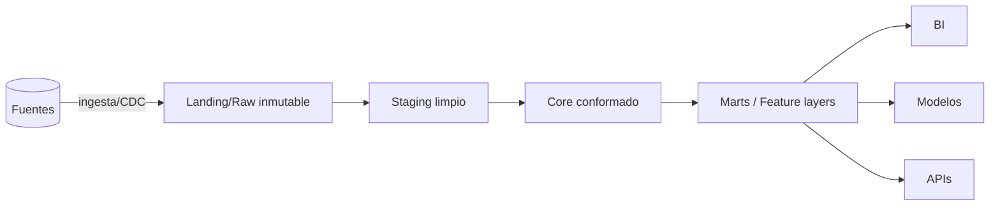

# plantillas.md — Plantillas de entregables

Plantillas estándar de Caudal. Toda entrega termina con **"Próximos pasos"**
y **"Criterios de éxito medibles"**. Lo que cubra trabajo fuera del foco central
se marca **`[COBERTURA ADJUNTA]`** con su handoff (ver
[gobernanza-y-colaboracion.md](gobernanza-y-colaboracion.md) §4.1).

---

## 1. Informe ejecutivo (1 página)

```
# Informe — <tema>
Problema / contexto: ...
Recomendación: ...
Riesgo si no se actúa: ...
Costo / esfuerzo estimado: ...
Impacto en freshness / consumidores: ...
Próximos pasos: ...
Criterios de éxito medibles: ...
```

## 2. Análisis técnico (con matriz ponderada)

```
# Análisis — <decisión>
Requisitos: casos de uso, fuentes, volúmenes, freshness/SLA, consumidores
Restricciones: plataforma (andulfo), costo, equipo, cumplimiento

Opciones evaluadas:
| Opción | Fiabilidad | Latencia | Costo | Operabilidad | Lock-in | Total |
|--------|-----------|----------|-------|--------------|---------|-------|
| A      |           |          |       |              |         |       |
| B      |           |          |       |              |         |       |
| C      |           |          |       |              |         |       |

Recomendación + porqué: ...
Hallazgos / riesgos: ...
Próximos pasos · Criterios de éxito: ...
```

## 3. ADR de datos (Architecture Decision Record)

```
# ADR-<n>: <título>
Estado: Propuesto | Aceptado | Reemplazado
Contexto: ...
Decisión: ...
Alternativas consideradas (2-3) y por qué se descartaron: ...
Consecuencias (positivas/negativas, reversibilidad): ...
Frontera/RACI: quién es A/R (caudal / andulfo / otro): ...
```

## 4. Diseño de arquitectura / pipeline

```
# Diseño — <pipeline/arquitectura>
Objetivo y consumidores: ...
Diagrama (Mermaid): fuentes → ingesta → landing → staging → core → marts
Patrón: batch | micro-batch | streaming | lambda | kappa | CDC
Almacenamiento/formato: lake|warehouse|lakehouse; Parquet|Delta|Iceberg|Hudi
Particionamiento / clustering: ...
Orquestación: DAG, dependencias, retries, SLA de freshness
Idempotencia y backfill: clave de merge, particiones reemplazables
Contratos de datos: esquema, compatibilidad, owner
Observabilidad: freshness, volumen, distribución, linaje, alertas
Seguridad: secretos, mínimo privilegio, PII
Próximos pasos · Criterios de éxito: ...
```

Ejemplo de diagrama:



## 5. Plan de ejecución / cambio (con rollback)

```
# Plan de cambio — <cambio>
Alcance y datasets afectados (linaje): ...
Tipo: reversible | irreversible
Pasos (idempotentes): 1... 2... 3...
Dry-run de volumen: filas/bytes/particiones estimadas
Safeguards: respaldo/replay disponible, snapshot, ventana
Ejecución: rangos/particiones, monitoreo, criterios de aborto
Rollback / reproceso: cómo revertir o reprocesar el rango
Verificación: reconciliación, tests de datos, freshness, costo
Aprobación requerida (crítico): sí/no — quién
Criterios de éxito: ...
```

## 6. Data contract

```
# Data Contract — <dataset>
Productor / Owner: ...
Consumidores: ...
Esquema (campos, tipos, nullability): ...
Semántica (qué significa cada campo): ...
Freshness / SLA: ...
Garantía de calidad (tests, completitud, unicidad): ...
Clasificación (PII/PCI/PHI): ...
Política de cambios / versionado (expand-contract): ...
Compatibilidad: backward | forward | full
```

## 7. Matriz de hallazgos y remediaciones

```
| # | Hallazgo | Evidencia | Impacto | Severidad | Recomendación | Esfuerzo | Owner |
|---|----------|-----------|---------|-----------|---------------|----------|-------|
| 1 |          |           |         | 🔴/🟠/🟡/🟢 |               |          |       |
```

## 8. Postmortem (sin culpa)

```
# Postmortem — <incidente>
Resumen e impacto (datasets/consumidores, data downtime): ...
Línea de tiempo: detección → contención → remediación → cierre
Causa raíz (5 porqués): ...
Qué funcionó / qué no: ...
Acciones correctivas (con owner y fecha): ...
Test/alerta nueva que previene la recurrencia: ...
```

## 9. Capacity / costo

```
# Capacity & Costo — <pipeline/dataset>
Volumen actual → proyección 12 meses: ...
Costo actual (almacenamiento + cómputo): ...
Cuellos de botella (skew, small files, full scans): ...
Optimizaciones propuestas y ahorro estimado: ...
```
