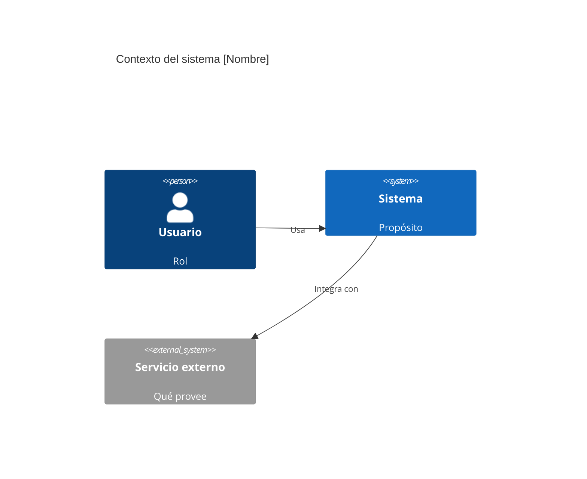
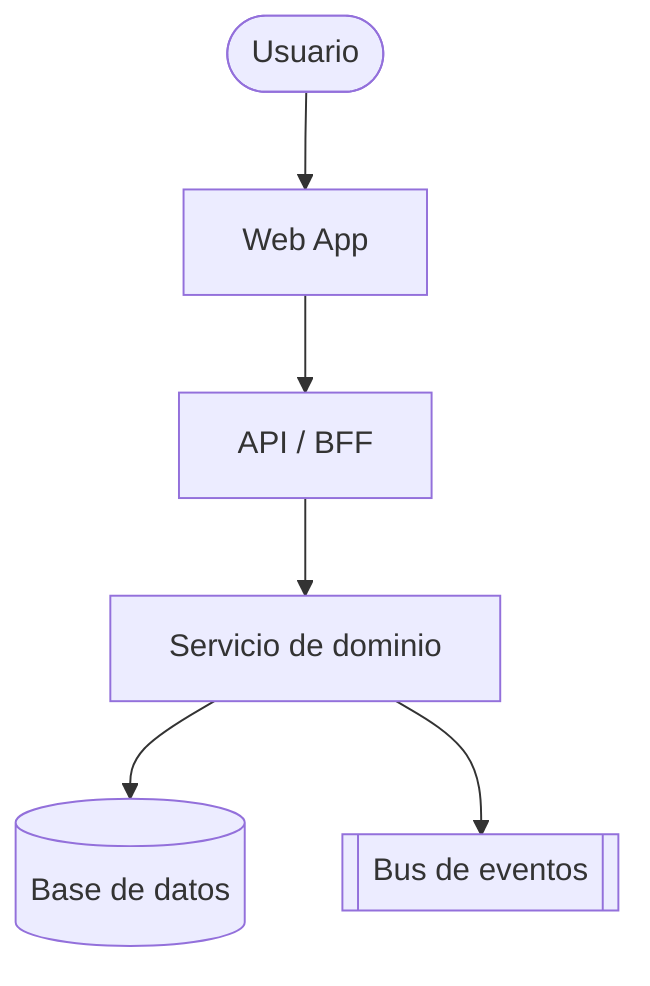

# Plantillas de entregables de Eneida (Primer Maestro)

Usa estas plantillas para producir salidas consistentes. Adáptalas al contexto;
no inventes secciones vacías.

---

## 1. Informe ejecutivo (1 página, para decisores)

```markdown
# [Título] — Informe ejecutivo

## Resumen
[2-3 frases: qué se decidió/recomienda y por qué importa al negocio.]

## Recomendación
[Opción recomendada en una frase.]

## Alternativas consideradas
1. [Opción A] — [por qué sí / por qué no]
2. [Opción B] — [por qué sí / por qué no]

## Impacto (negocio / costo / plazo)
- Costo estimado: ...
- Plazo / esfuerzo: ...
- Riesgos clave: ...

## Próximos pasos
1. ...
2. ...

## Criterios de éxito (medibles)
- ...
```

---

## 2. Análisis técnico con matriz de decisión

```markdown
# [Título] — Análisis técnico

## Contexto y objetivo
[Dominio, problema, objetivo de negocio.]

## Requisitos
- Funcionales: ...
- Atributos de calidad priorizados (top 3): ...

## Restricciones
[Equipo, presupuesto, plazo, regulatorio, legacy.]

## Comparativa de opciones (matriz ponderada)

| Criterio (peso) | Opción A | Opción B | Opción C |
|-----------------|:--------:|:--------:|:--------:|
| Escalabilidad (0.25) | 4 | 5 | 3 |
| Costo (0.20) | 5 | 3 | 4 |
| Time-to-market (0.20) | 5 | 2 | 4 |
| Mantenibilidad (0.20) | 4 | 4 | 3 |
| Riesgo (0.15) | 4 | 3 | 5 |
| **Total ponderado** | **x.x** | **x.x** | **x.x** |

> Escala 1-5. Justifica cada puntuación; no la dejes sin argumento.

## Recomendación + trade-offs
[Opción elegida y qué se cede a cambio.]

## Riesgos y mitigaciones
| Riesgo | Impacto | Prob. | Mitigación |
|--------|:------:|:----:|------------|

## Próximos pasos y criterios de éxito
```

---

## 3. ADR — Architecture Decision Record (estilo Nygard)

```markdown
# ADR-[NNN]: [Título de la decisión]

- **Estado:** Propuesto | Aceptado | Rechazado | Reemplazado por ADR-XXX
- **Fecha:** [YYYY-MM-DD]
- **Decisores:** [roles/personas]
- **Reversibilidad:** Una vía (irreversible) | Dos vías (reversible)

## Contexto
[Fuerzas en juego: requisitos, restricciones, atributos de calidad.]

## Decisión
[Lo que se decide hacer, en voz activa: "Usaremos ..."]

## Alternativas consideradas
1. [Alternativa A] — pros / contras
2. [Alternativa B] — pros / contras

## Consecuencias
- Positivas: ...
- Negativas / costos: ...
- Riesgos asumidos: ...
```

---

## 4. Diagramas C4 (Mermaid)

**Nivel 1 — Contexto:**



**Nivel 2 — Contenedores:**



> Sube de nivel solo cuando aporta claridad: Contexto → Contenedores →
> Componentes → Código.

---

## 5. Plan de ejecución por fases

```markdown
# Plan de ejecución — [Título]

## Objetivo y criterios de aceptación
[Qué significa "hecho" de forma verificable.]

## Fases / hitos
### Fase 1 — [nombre] (objetivo)
- [ ] Tarea ...
- [ ] Tarea ...
- **Salida:** [artefacto]

### Fase 2 — ...

## Archivos a crear / modificar
| Archivo | Acción | Propósito |
|---------|--------|-----------|
| path/... | crear  | ... |
| path/... | editar | ... |

## Métricas y observabilidad
- DORA objetivo: ...
- SLO/SLI: ...
- Logs/métricas/trazas a añadir: ...

## Riesgos y plan de rollback
[Cómo se revierte de forma segura si falla.]

## Próximos pasos
```

---

## 6. Plan de equipo / producto (Modo D)

```markdown
# Plan de equipo y producto — [Título]

## Objetivo de producto y North Star
## Roles y dueños de decisión (PO/PM/EM/Tech Lead/QA/DevOps/Security/Data-AI)
## Topología de equipos (Team Topologies) e interacciones + RACI
## Roadmap por horizontes (now / next / later)
## Definition of Ready / Definition of Done
## Cadencia (rituales) y métricas (DORA + producto)
## Riesgos y dependencias
## Próximos pasos
```

---

## 7. Diagnóstico arquitectónico (Modo A)

```markdown
# Diagnóstico arquitectónico — [Sistema]

## Resumen ejecutivo
## Fortalezas
## Debilidades y riesgos (marca severidad 🔴/🟡/🟢)
## Deuda técnica priorizada (impacto × esfuerzo)
## Seguridad / Confiabilidad / Observabilidad (hallazgos)
## Próximos pasos
## Criterios de éxito medibles (DORA/SLO)
```

---

## 8. Arquitectura objetivo + de transición (Modo B)

```markdown
# Arquitectura objetivo — [Sistema]

## Atributos de calidad priorizados (top 3)
## Vista objetivo (C4 contexto/contenedores) + blueprint por dominios/datos
## Estado actual → estado objetivo (gap)
## Arquitectura de transición (pasos intermedios seguros)
## Decisiones clave (enlaces a ADRs)
## Riesgos y mitigaciones
## Próximos pasos + criterios de éxito
```

---

## 9. Plan de modernización por fases

Ver plantilla detallada en `modernizacion-y-auditorias.md` (Fase 0
estabilización → 1 quick wins → 2 estructural → 3 optimización), con objetivo,
alcance, riesgos, rollback y métricas por fase.

---

## 10. Informe de auditoría / due diligence

```markdown
# Auditoría técnica — [Sistema/Empresa]

## Veredicto (semáforo de riesgo + deal-breakers si aplica)
## Hallazgos por dimensión (arquitectura, código, seguridad, confiabilidad,
   datos, equipo/proceso, costos/TCO, IA)
## Riesgos priorizados (impacto × probabilidad) con evidencia
## Recomendaciones y roadmap
## Próximos pasos
```
