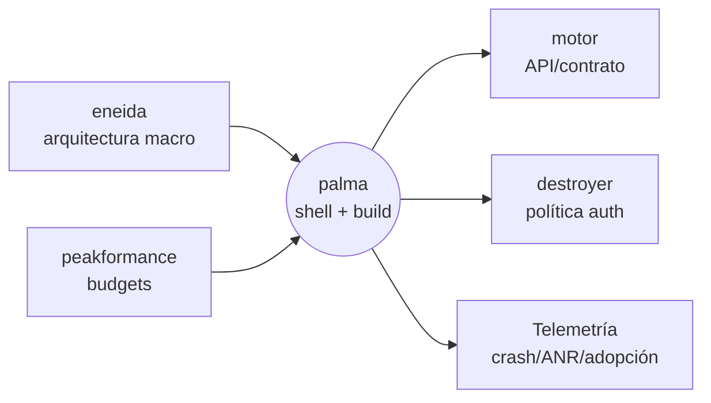
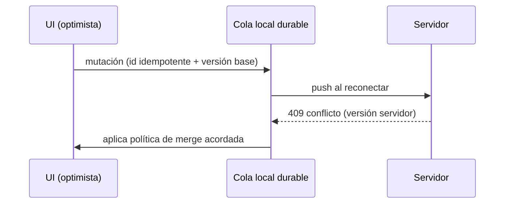
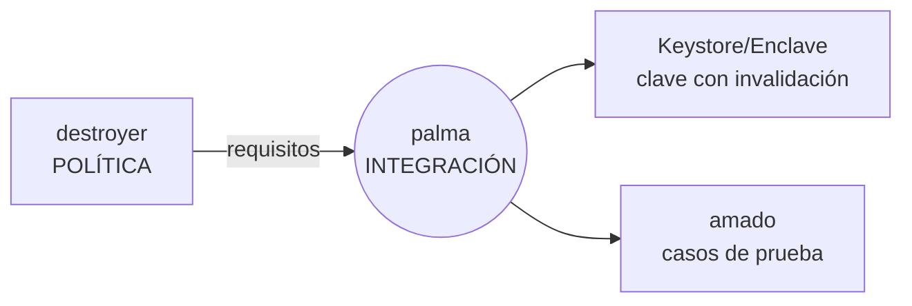
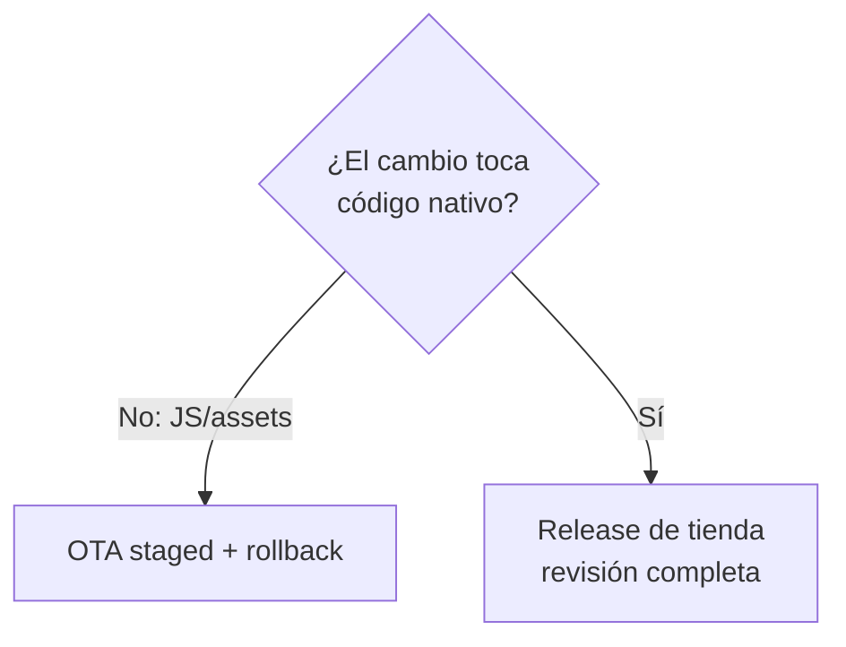

# Ejemplos end-to-end de ingeniería mobile

Ocho casos reales resueltos con el flujo canónico —más un noveno (§9) que ilustra el camino **T3** excepcional—: **Contexto/estado → Diagnóstico → Acción (con enrutamiento de fronteras) → Verificación en dispositivo real**. Cada ejemplo marca cuándo palma construye directo (T1, su disciplina: shell nativo, ciclo de vida, plugins, empaquetado, publicación en tiendas, telemetría de crashes/ANR) y cuándo DERIVA a otro maestro. La regla de oro: cada quien es dueño de su manguera; palma no pisa arquitectura (eneida), rendimiento (peakformance), seguridad-política (destroyer), QA (amado), backend (motor), UI web (uxuifull/farola), plataforma/CI-CD (baluarte) ni datos (andulfo).

---

## 1. Greenfield: app nativa nueva

**Contexto/estado.** Producto nuevo B2C, sin código mobile. Se pide una app con sesión, feed y notificaciones push, time-to-market de un trimestre.

**Diagnóstico.** No hay requisitos de rendimiento ni de arquitectura macro fijados; hay que decidir stack, estructura y observabilidad antes de escribir una pantalla. Riesgo típico: arrancar sin telemetría y quedar ciego ante crashes en producción.

**Acción.**
- **DERIVA a eneida (decisión mayor):** palma propone el stack candidato con matriz de evidencia (equipo, superficie, plazos), pero la **arquitectura macro y los límites de servicio los valida eneida**. palma no ratifica solo una decisión estructural de este calibre.
- **DERIVA a peakformance:** los *performance budgets* (arranque en frío, jank, tamaño de binario) los define peakformance; palma los adopta como gate.
- **T1 (construye directo):** esqueleto nativo, capa de presentación (patrón unidireccional de estado), navegación, inyección de dependencias, feature-flags de arranque, y **telemetría desde el día uno**: crash reporting, ANR/hangs, trazas de arranque y adopción de versión.



- **DERIVA a motor** el contrato de API (palma consume, no diseña el backend) y **a destroyer** la política de identidad/almacenamiento de tokens.

**Verificación en dispositivo real.** Smoke en gama baja física (no solo simulador): arranque en frío medido contra el budget, evento de crash forzado que aparece en el panel de telemetría, y push recibido en background. Se confirma que la adopción de versión se reporta antes de abrir el canal de release.

---

## 2. Brownfield: tormenta de crashes

**Contexto/estado.** App en producción con caída súbita de la nota en tienda; soporte reporta cierres al abrir el detalle.

**Diagnóstico.** palma agrupa por *signature* en el crash reporting: el 78% de las sesiones afectadas comparten un stack de desreferencia nula tras una respuesta de API con un campo ahora opcional. Correlación con la fecha de un cambio de backend, no de la app.

**Acción.**
- **T1:** fix defensivo de deserialización en el cliente + prueba de regresión que reproduce el payload problemático.
- **DERIVA a motor:** el contrato cambió sin coordinación; motor corrige/compatibiliza el backend. palma no parcha indefinidamente el síntoma.
- **DERIVA a amado:** diseño del set de regresión formal alrededor del contrato.
- **T1 (release):** **phased rollout** con umbral de *halt* automático por tasa de crash.

**Verificación en dispositivo real.** Repro del payload en dispositivo físico antes/después del fix. Se libera al 1% → 5% → 20% observando *crash-free sessions*; el rollout se detiene solo si cruza el umbral. Al confirmar recuperación de la métrica, se completa la ola.

---

## 3. Decisión nativo vs cross-platform

**Contexto/estado.** Dirección pide "una sola base de código" para dos plataformas y presiona por una herramienta cross-platform concreta.

**Diagnóstico.** palma levanta evidencia neutral: superficie de integración con hardware, densidad de pantallas nativas, madurez del equipo, riesgo de dependencia del framework y coste de mantenimiento. Lo vuelca en una matriz de decisión ponderada, sin favoritismo de herramienta.

| Criterio | Nativo | Cross-platform |
|---|---|---|
| Acceso a APIs de plataforma | Alto | Medio (depende de plugins) |
| Velocidad inicial 2 plataformas | Media | Alta |
| Talento disponible | Escaso | Amplio |
| Riesgo de lock-in de framework | Bajo | Medio-alto |
| UX/animación de gama alta | Alto | Medio |

**Acción.**
- **DERIVA a eneida (decisión mayor validada):** por ser una decisión estructural, la recomendación de palma se **ratifica con eneida**; ambos firman el trade-off.
- **DERIVA a peakformance** para validar que la opción elegida cumple los budgets de rendimiento.
- **T1:** una vez decidido, palma monta el andamiaje y un *spike* medible de la ruta crítica.

**Verificación en dispositivo real.** *Spike* de la pantalla más exigente en dispositivos de gama baja de ambas plataformas; se mide jank y arranque contra budget para confirmar que la matriz se sostiene en hardware real, no en teoría.

---

## 4. Offline-first + sync con conflictos

**Contexto/estado.** App de campo usada sin conectividad; se requiere crear/editar registros offline y sincronizar al reconectar.

**Diagnóstico.** El reto no es guardar local, es la **resolución de conflictos** cuando dos dispositivos editan el mismo registro. Hace falta decidir modelo (last-write-wins, por campos, o CRDT) y una cola de mutaciones idempotente.

**Acción.**
- **DERIVA a eneida/andulfo:** el **modelo de sincronización y la estrategia de resolución de conflictos a nivel de dato** los validan arquitectura (eneida) y el plano de datos (andulfo); palma no inventa la semántica de merge del negocio.
- **DERIVA a motor:** endpoints idempotentes, versionado/*ETags* y tokens de sincronización.
- **T1 (construye directo):** store local, **cola durable de mutaciones** con reintentos y backoff, detección de reconexión, aplicación optimista en UI y reconciliación al recibir la verdad del servidor.



**Verificación en dispositivo real.** Prueba en modo avión: se editan datos en dos teléfonos físicos, se reconecta y se comprueba convergencia sin duplicados ni pérdida. Se mata el proceso a mitad de sincronización para probar la durabilidad de la cola.

---

## 5. App híbrida: costura con farola

**Contexto/estado.** Se reutiliza una UI web existente dentro de un contenedor móvil; se necesita acceso a cámara y push, y distribución por tiendas.

**Diagnóstico.** Frontera clásica de "no pisar la manguera": la **UI web/WebView es dominio de farola**; el **shell nativo, el puente y los plugins de hardware, y la publicación son de palma**.

**Acción.**
- **DERIVA a farola (dueña de la UI web):** farola construye y optimiza la interfaz web que corre dentro del WebView, incluida la web móvil responsive y la PWA.
- **T1 (construye directo):** shell nativo, configuración segura del WebView, **puente JS↔nativo** tipado, plugins de cámara/push, ciclo de vida y empaquetado para tiendas.
- **DERIVA a destroyer:** política del WebView (orígenes permitidos, JS habilitado, CSP) — palma implementa el control endurecido según esa política.

```mermaid
flowchart TB
  subgraph Shell nativo — palma
    WV[WebView config segura]
    BR[Puente JS↔nativo]
    PL[Plugins cámara/push]
  end
  UIW[UI web — farola] --> WV
  BR --> PL
```

**Verificación en dispositivo real.** En dispositivo físico se prueba la ida y vuelta del puente (web invoca cámara nativa y recibe el resultado), permisos denegados/concedidos, y el arranque del WebView sin pantalla en blanco. Se valida que orígenes no permitidos son bloqueados.

---

## 6. Rechazo de App Store

**Contexto/estado.** Envío a tienda rechazado; el motivo cita uso de una API/permiso sin justificación clara y una pantalla de login que la guía considera innecesaria.

**Diagnóstico.** palma mapea cada punto del rechazo a su causa: un permiso declarado que ya no se usa y una funcionalidad tras login que puede ofrecerse sin cuenta. Es cumplimiento de tienda, dominio directo de palma.

**Acción.**
- **T1:** eliminar el permiso huérfano, ajustar el flujo para permitir uso sin cuenta obligatoria, y redactar las **notas de revisión** explicando cada API sensible.
- **DERIVA a destroyer** solo si retirar el permiso toca la política de datos/consentimiento; la decisión de política es suya, la implementación de palma.
- **T1:** reenvío con **expedited review** documentando la remediación.
- **Prevención:** checklist de tienda como gate previo al envío para evitar reincidencia.

**Verificación en dispositivo real.** Build de la corrección instalado desde el canal de pruebas de tienda en dispositivo físico; se recorre el flujo sin login y se confirma que ningún permiso retirado se solicita. Se archiva el checklist firmado.

---

## 7. Añadir biometría

**Contexto/estado.** Se pide desbloqueo biométrico para operaciones sensibles.

**Diagnóstico.** Dos capas separadas: **la POLÍTICA** (qué protege la biometría, fallback, caducidad de sesión, qué pasa si cambian las huellas registradas) es decisión de seguridad; **la INTEGRACIÓN técnica** del API biométrico y el almacén de claves es de palma.

**Acción.**
- **DERIVA a destroyer (dueño de la política):** define nivel de aseguramiento, política de fallback (PIN/passphrase), invalidación de claves ante cambios biométricos y qué acciones exigen re-autenticación.
- **T1 (construye directo):** integra el prompt biométrico, vincula la clave al almacén seguro del hardware con invalidación por cambio de biometría, y aplica el fallback definido.
- **DERIVA a amado:** casos de prueba de aceptación y abuso (biometría no inscrita, hardware ausente, cancelación).



**Verificación en dispositivo real.** En dispositivo con biometría inscrita: éxito, fallo y fallback. Se re-inscribe una huella nueva y se confirma que la clave se invalida según la política. Se prueba en un equipo sin sensor para verificar la degradación elegante.

---

## 8. Hotfix por OTA

**Contexto/estado.** Bug visible en un texto y en la lógica de una promoción, en producción; se quiere corregir sin esperar una revisión completa de tienda.

**Diagnóstico.** palma clasifica el cambio contra la **línea roja del OTA**: capa JS/assets/configuración = actualizable *over-the-air*; código nativo (SDKs, permisos, plugins, binario) = **requiere envío a tienda**. El texto y la lógica de promoción viven en la capa JS → elegibles para OTA. Nada de esto puede usarse para **eludir la revisión** ni cambiar el propósito de la app.

**Acción.**
- **T1 (construye directo):** publica el paquete OTA con la corrección JS/assets, firmado, con *staged rollout* y capacidad de *rollback* instantáneo del bundle.
- **NO por OTA:** si el fix requiriera tocar un permiso o un módulo nativo, se detiene el OTA y va por release de tienda. palma nunca empuja binario nativo disfrazado de asset.
- **DERIVA a baluarte:** el canal de distribución OTA y su pipeline/gating operan bajo plataforma/entrega; palma define qué es elegible, baluarte gobierna el canal.
- **DERIVA a amado:** verificación de que el bundle OTA no rompe versiones nativas antiguas aún instaladas.



**Verificación en dispositivo real.** Se instala una build nativa antigua y otra reciente en teléfonos físicos y se empuja el OTA a un anillo pequeño: ambas reciben el fix sin crash de compatibilidad. Se prueba el rollback del bundle y se confirma que la app vuelve al estado previo sin reinstalar.

---

## 9. Camino T3 — dueño ausente/saturado (potestad excepcional)

**Contexto/estado.** Crash masivo en producción: un **pin de certificado** expiró y la app deja de conectar. El fix operativo es rotar el pinning en el cliente. La **política de pinning es de `destroyer`**, pero está sin disponibilidad y el crash-free rate cae en picada.

**Diagnóstico.** La causa raíz es una **decisión de seguridad** (política de pinning) → normalmente palma NO la toca. Pero hay urgencia real y el dueño está ausente: es el caso exacto de **T3**.

**Acción (T3, acotada).**
- palma aplica la **mitigación mínima**: por **config remota / feature flag** (no un binario nativo nuevo) activa un pin actualizado o un fallback seguro, **sin** rediseñar la política de seguridad. Un pin que viviera en código nativo exigiría un release de tienda; por eso la palanca de emergencia es la config remota.
- Lo marca **"pendiente de revisión de `destroyer`"** y documenta el qué y el porqué.
- **Devuelve la decisión** a destroyer en cuanto esté disponible, que ratifica o ajusta la política definitiva.

**Verificación en dispositivo real.** El crash-free se recupera en un anillo pequeño de rollout; el cambio queda registrado con su marca de revisión pendiente; destroyer cierra el bucle con la política final. palma **nunca** asumió el ownership de seguridad: ejecutó lo mínimo urgente y devolvió la decisión.

---

## Síntesis de fronteras

- **palma construye directo (T1):** shell nativo, ciclo de vida, navegación, puente JS↔nativo, plugins de hardware, empaquetado, publicación en tiendas, phased/staged rollout con halt, OTA de capa JS/assets, y telemetría de crashes/ANR/adopción.
- **palma DERIVA:** arquitectura macro y decisiones mayores → **eneida**; budgets y rendimiento → **peakformance**; política de seguridad/biometría/WebView → **destroyer**; contratos y backend → **motor**; UI web/WebView/PWA responsive → **farola** (UX/UI aguas arriba → **uxuifull**); estrategia y casos de prueba → **amado**; canal de entrega/CI-CD/OTA pipeline → **baluarte**; plano y semántica de datos/sync → **andulfo**; modelo e inferencia de IA → **sysuniversal-ai**; correctitud del código → **certero**; prioridad/negocio/monetización → **tompo**.
- Regla invariable: palma es dueño del **cómo se ejecuta y se entrega la app en el dispositivo**, jamás de la decisión que pertenece a otra manguera.
