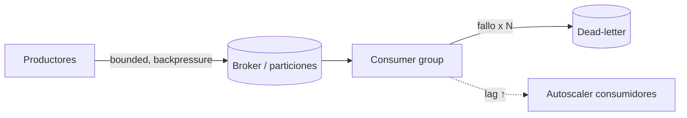

# Escalabilidad y sistemas distribuidos

Dominio de peakformance sobre cómo un ecosistema **sostiene carga creciente sin degradar el tail**. Escalar no es "agregar nodos": es entender contención, coherencia y latencia de cola. Aquí gobernamos las decisiones cross-cutting (T1) y coordinamos los cambios de servicio/arquitectura con **motor** y **eneida** (T2). Sin sesgo de vendor: toda tecnología entra como *p. ej.* y se elige por evidencia y contexto. Ver [estrategia-performance.md](estrategia-performance.md) para el marco global y [metodologia-diagnostico.md](metodologia-diagnostico.md) para el método de causa raíz.

## 1. Escalar vertical vs horizontal vs optimizar

Antes de escalar, **medir y decidir con criterio de costo/límite/riesgo**. Muchas veces optimizar el código o la consulta (ver [backend-performance.md](backend-performance.md), [datos-performance.md](datos-performance.md)) rinde más que duplicar infraestructura.

| Eje | Vertical (scale-up) | Horizontal (scale-out) | Optimizar |
|-----|--------------------|-----------------------|-----------|
| Costo marginal | Sube no-lineal (hardware premium) | ~Lineal hasta contención | Puntual, alto ROI |
| Techo | Límite físico del nodo | Límite por coherencia (USL) | Límite algorítmico |
| Riesgo | SPOF, blast radius grande | Complejidad distribuida | Regresión funcional |
| Reversibilidad | Alta | Media | Alta (con tests) |
| Cuándo | Estado difícil de repartir, quick win | Carga elástica, sin estado | Hotspot identificado |

Regla: **optimiza primero lo que domina el perfil**, luego escala la dimensión que el análisis (no la intuición) señale. Toda decisión se justifica con antes/después en percentiles. El análisis de **complejidad algorítmica** (el fix más barato suele ser el algoritmo, no más hardware) vive en [metodologia-diagnostico.md](metodologia-diagnostico.md) §7.2.

## 2. Universal Scalability Law (Gunther) — por qué el escalado se aplana

La USL modela el throughput relativo `C(N)` según nodos/concurrencia `N`, con dos penalizaciones: **contención σ** (serialización, colas por recurso compartido) y **coherencia κ** (costo de sincronizar estado entre nodos, crece con `N²`).

```
C(N) = N / (1 + σ·(N-1) + κ·N·(N-1))
```

- σ > 0: la curva se **aplana** (ley de Amdahl como caso κ=0).
- κ > 0: la curva **degrada** — hay un `N*` óptimo; pasado ese punto, agregar nodos empeora.
- `N* = sqrt((1-σ)/κ)`.

Implicación operativa: si al duplicar nodos el throughput sube <2x y el p99 sube, **estás pagando coherencia**. La cura no es más nodos: es reducir estado compartido (sharding, caches locales, idempotencia) o serialización (locks, secciones críticas). Diagnóstico detallado en [metodologia-diagnostico.md](metodologia-diagnostico.md); relación con capacidad y costo en [infra-capacidad-costo.md](infra-capacidad-costo.md).

## 3. Tail latency — "The Tail at Scale" (Dean & Barroso)

En fan-out, **el p99 de cada componente domina el p50 del sistema**. Si una request toca 100 servicios en paralelo y cada uno tiene p99=10ms, la probabilidad de que *alguno* pegue el tail es ~63%: el p50 del agregado ≈ p99 del componente.

```
P(request lenta) = 1 - (1 - p_lento_componente)^fanout
```

Tácticas de **tail-tolerance** (elegir por contexto):

| Táctica | Qué hace | Costo / riesgo |
|---------|----------|----------------|
| Hedged requests | Envía la 2ª copia tras esperar p95; usa la 1ª que responda | +5% carga; reduce p99 drásticamente |
| Backup requests + cancel | Igual pero cancela la perdedora | Requiere cancelación cooperativa |
| Timeouts por percentil | Corta en p99·k, no en promedio | Mal calibrado genera reintentos tormenta |
| Tied requests | Encola en 2 réplicas, la que empieza cancela la otra | Coordinación entre réplicas |
| Micro-particiones | Muchas particiones pequeñas → rebalanceo fino | Overhead de metadata |

Nunca dimensiones timeouts ni SLOs con promedios. Todo se expresa en percentiles (p50/p95/p99/p99.9). Ver instrumentación de tails en [medicion-observabilidad.md](medicion-observabilidad.md).

## 4. Balanceo de carga

peakformance define (T1) la **política de balanceo**; la implementación en el servicio/proxy la co-ejecuta **motor**/**eneida**.

| Algoritmo | Cuándo brilla | Debilidad |
|-----------|---------------|-----------|
| Round-robin | Nodos homogéneos, requests uniformes | Ignora carga real → hot node |
| Least-connections | Requests de duración variable | No ve latencia, solo conexiones |
| EWMA / least-latency (p. ej. P2C — power of two choices) | Heterogéneo, evita "herd" | Necesita señal de latencia fresca |
| Weighted | Capacidad desigual conocida | Pesos estáticos envejecen |
| Consistent hashing | Afinidad de caché/sesión | Rebalanceo en cambios de topología |

- **Sticky/afinidad** solo si el estado lo exige; encarece rebalanceo y crea hot nodes. Prefiere estado externalizado.
- **Health checks**: activos (probe) + pasivos (circuito por errores). Distingue *liveness* (¿vive?) de *readiness* (¿acepta tráfico?) y *load* (¿debería recibir menos?). Un check mal calibrado saca nodos sanos bajo tail y colapsa el resto.
- **Power of Two Choices**: elige 2 nodos al azar y manda al menos cargado — casi óptimo con costo O(1) y sin punto central.

## 5. Backpressure y control de flujo

Sin backpressure, un pico no se degrada: **colapsa** (colas ilimitadas → memoria agotada → latencia infinita → cascada). Por Little's Law `L = λ·W`: si la tasa de llegada λ supera la de servicio y `W` no se acota, `L` (y la latencia) crece sin techo.

Principios (T1, config transversal):

- **Colas acotadas (bounded queues)** siempre. Cola llena = señal, no error a esconder.
- **Load shedding**: rechaza pronto y barato (429/503) antes de aceptar trabajo que no terminarás a tiempo. Prioriza por clase de tráfico.
- **Rate limiting / concurrency limiting**: token bucket, leaky bucket, o límites adaptativos (p. ej. AIMD estilo TCP Vegas sobre latencia observada).
- **Propagación**: el backpressure debe viajar aguas arriba (el consumidor lento frena al productor), no acumularse en un buffer intermedio.

```
recibir(req):
  if cola.llena() or inflight >= limite_concurrencia:
     return SHED(503, retry_after)      # falla rápido y barato
  if deadline_excedido(req):
     return SHED(504)                    # no trabajes lo ya perdido
  cola.push(req)
```

## 6. Colas y mensajería

Foco de performance, no solo de entrega:

- **Throughput vs latencia**: batching y compresión suben throughput pero añaden latencia; parametrízalo por SLO.
- **Consumer lag** es la métrica reina: lag creciente = λ_producción > λ_consumo → escala consumidores o aplica shedding en el productor. Alértalo por tendencia, no por umbral fijo.
- **Ordering**: el orden total es caro; casi siempre basta orden *por clave/partición*. No pagues orden global si el dominio no lo exige.
- **Poison messages**: DLQ + límite de reintentos con backoff exponencial + jitter; sin esto, un mensaje venenoso bloquea la partición.
- **Semánticas**: `at-least-once` (default barato) exige **idempotencia** en el consumidor; `exactly-once` es caro (dedup + transacciones/outbox) — úsalo solo donde el negocio lo justifique.



## 7. Sharding / partitioning

- **Elección de clave**: alta cardinalidad + distribución uniforme del *acceso* (no solo de los datos). Clave temporal o secuencial → hot shard garantizado.
- **Hot shards**: detecta por skew de QPS/latencia por partición; mitiga con salting, sub-particionado o clave compuesta.
- **Rebalanceo**: consistent hashing (con nodos virtuales) minimiza el movimiento de datos al cambiar topología; hashing modular reubica casi todo.
- Coordina el modelo de partición con **andulfo** (datos) y **eneida** (fronteras de servicio). Detalle de persistencia en [datos-performance.md](datos-performance.md).

## 8. Consistencia vs latencia (CAP / PACELC)

CAP solo aplica bajo partición; **PACELC** es más útil día a día: *si Partición → A o C; Else → L o C*. La mayoría de sistemas de alto rendimiento eligen `PA/EL` (disponibilidad y baja latencia) con consistencia eventual acotada.

| Necesidad | Modelo | Efecto en latencia |
|-----------|--------|--------------------|
| Lecturas escalables | Réplicas de lectura + read-your-writes | Baja; riesgo de staleness |
| Fuerte global | Consenso (quórum) | Alta cola por coordinación |
| Sesión/monotónica | Consistencia causal | Media, buen balance |

Réplicas de lectura descargan al primario pero introducen **replication lag**: mídelo y expónlo; enruta lecturas sensibles al primario. No prometas fuerte donde solo tienes eventual.

## 9. CDN / edge y topologías de caché

Mover cómputo y datos al borde recorta RTT y absorbe picos. La estrategia de caché es multinivel; peakformance define la **topología** (T1).

```
Cliente → Browser cache → CDN/edge → Reverse proxy → App cache (local/distribuida) → Origen/BD
```

Claves: TTL vs invalidación por evento, `stale-while-revalidate`, cache-key correcta (evita fragmentación/poisoning), y protección contra **cache stampede** (request coalescing / locks de regeneración). Detalle de borde y cliente en [frontend-performance.md](frontend-performance.md); la taxonomía de estrategias e invalidación/stampede (común a las tres capas) tiene su **fuente canónica** en [datos-performance.md](datos-performance.md) §6 (a la que también remite [backend-performance.md](backend-performance.md) §4).

## 10. Fan-out/fan-in, circuit breakers y bulkheads

- **Fan-out/fan-in**: paraleliza dependencias independientes; el latido del agregado = el más lento (sección 3). Aplica hedging y timeouts por dependencia; degrada parcialmente (respuesta incompleta > timeout total).
- **Circuit breaker**: abre ante fallos/latencia sostenida para **liberar** al dependiente y fallar rápido; half-open para probar recuperación. Métrica: tasa de error y latencia, no solo excepciones.
- **Bulkheads**: aísla pools de conexiones/threads por dependencia para que un cuello no consuma todos los recursos y tumbe lo sano.

## 11. Autoscaling

peakformance define **métricas de disparo y políticas** (T1); su implementación en el orquestador (p. ej. HPA/KEDA, autoscaling groups, funciones serverless) se coordina con **eneida**/plataforma.

| Enfoque | Señal de disparo | Fortaleza | Riesgo |
|---------|------------------|-----------|--------|
| Reactivo | CPU, RPS, cola/lag, latencia p95 | Simple, robusto | Reacciona tarde en picos |
| Predictivo | Series de tiempo, estacionalidad | Adelanta picos conocidos | Modelo erra en eventos raros |
| Scheduled | Calendario | Cargas previsibles | Ciego a lo inesperado |

- Escala por la métrica que **causa** la saturación (lag de cola, concurrencia inflight) mejor que por CPU indirecta.
- **Cold start**: precalentamiento, pools mínimos, imágenes ligeras, snapshotting. Mídelo — un cold start alto arruina el p99 tras escalar.
- Estabiliza con cooldowns/histéresis para evitar *flapping*. Valida toda política con [pruebas-de-carga.md](pruebas-de-carga.md) y guárdala como código ([performance-cicd.md](performance-cicd.md)).

## 12. Checklist de escalabilidad

- [ ] Antes de escalar: perfil claro y decisión vertical/horizontal/optimizar justificada por costo/límite/riesgo.
- [ ] USL estimada (σ, κ): conocemos dónde se aplana o degrada la curva y por qué.
- [ ] SLOs y timeouts expresados en **percentiles** (p95/p99/p99.9), nunca promedios.
- [ ] Tail-tolerance activo donde hay fan-out (hedging/backup requests, timeouts por percentil).
- [ ] Balanceo elegido por evidencia; health checks distinguen liveness/readiness/load.
- [ ] **Backpressure end-to-end**: colas acotadas, load shedding, rate/concurrency limiting.
- [ ] Colas: consumer lag monitorizado por tendencia; DLQ + idempotencia; ordering solo donde se exige.
- [ ] Sharding: clave sin skew; hot shards detectables; rebalanceo con consistent hashing.
- [ ] Consistencia declarada por caso (PACELC); replication lag medido y ruteo consciente.
- [ ] Topología de caché/CDN definida; protección de stampede e invalidación correcta.
- [ ] Circuit breakers y bulkheads con umbrales basados en latencia y error.
- [ ] Autoscaling: métrica de disparo causal, cold start medido, histéresis anti-flapping.
- [ ] Evidencia antes/después en percentiles; cambios de servicio entregados vía **motor**/**eneida**.

---

Hermanos: [estrategia-performance.md](estrategia-performance.md) · [metodologia-diagnostico.md](metodologia-diagnostico.md) · [medicion-observabilidad.md](medicion-observabilidad.md) · [frontend-performance.md](frontend-performance.md) · [backend-performance.md](backend-performance.md) · [datos-performance.md](datos-performance.md) · [infra-capacidad-costo.md](infra-capacidad-costo.md) · [pruebas-de-carga.md](pruebas-de-carga.md) · [performance-cicd.md](performance-cicd.md) · [ia-ml-performance.md](ia-ml-performance.md) · [interoperabilidad-y-aliadas.md](interoperabilidad-y-aliadas.md) · [sistemas-hardware.md](sistemas-hardware.md) · [tiempo-real-embebido.md](tiempo-real-embebido.md) · [plantillas.md](plantillas.md) · [ejemplos.md](ejemplos.md)
