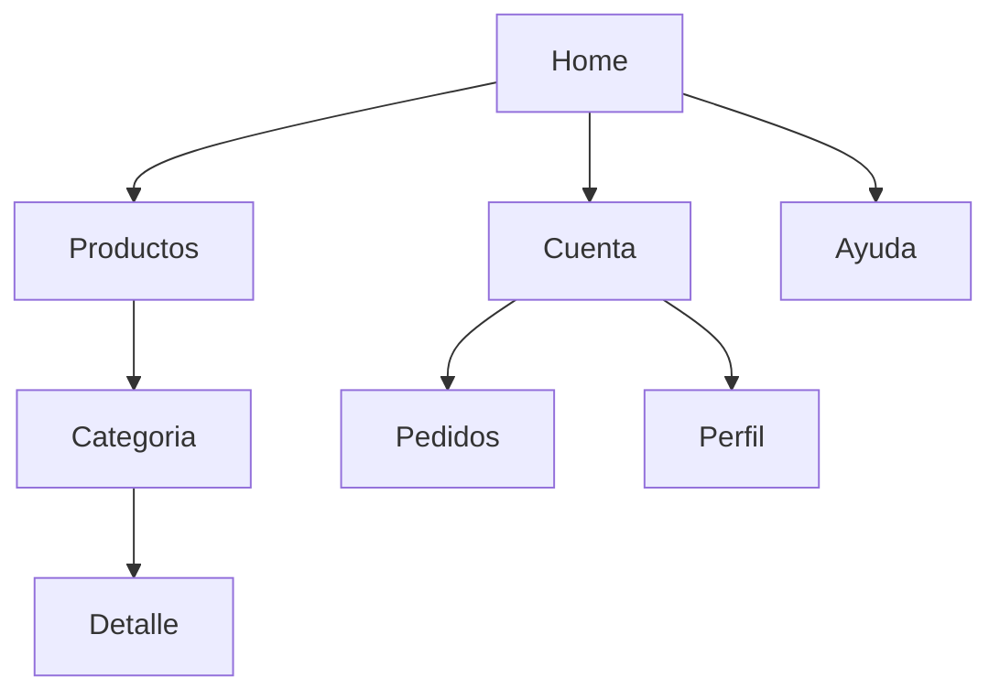

# Arquitectura de Información (IA)

Estructura la información para que sea **encontrable, entendible y navegable**.
La IA precede a la interfaz: define el esqueleto sobre el que se construye todo.

## 1. Fundamentos

- Los **cuatro sistemas** de Rosenfeld/Morville: organización, etiquetado,
  navegación y búsqueda. Toda IA se diseña en estas cuatro capas.
- Objetivo doble: **findability** (encontrar lo que buscas) y **understanding**
  (entender dónde estás y qué puedes hacer).
- Alinea la estructura con el **modelo mental** del usuario, no con el
  organigrama interno de la empresa (evita "org-chart IA").

## 2. Inventario y auditoría de contenido

- **Content inventory**: catálogo de todo el contenido existente (URL, tipo,
  dueño, estado, calidad).
- **Content audit**: evalúa relevancia, precisión, duplicidad, vacíos y
  obsolescencia → decide mantener/fusionar/reescribir/eliminar (ROT: Redundant,
  Outdated, Trivial).

## 3. Sistemas de organización

- **Esquemas exactos** (alfabético, cronológico, geográfico): sin ambigüedad,
  buenos cuando el usuario sabe qué busca.
- **Esquemas ambiguos** (por tema, tarea, audiencia, metáfora): más útiles para
  explorar, pero requieren validación con usuarios.
- **Estructuras**: jerárquica (la más común), secuencial (flujos guiados),
  matricial (múltiples ejes), facetada (filtros combinables, ideal en
  e-commerce y catálogos grandes).
- Equilibrio **amplitud vs profundidad**: evita árboles demasiado profundos
  (clics excesivos) o demasiado anchos (sobrecarga). Regla práctica: prioriza
  amplitud sobre profundidad en navegación principal.

## 4. Taxonomía, etiquetado y metadata

- **Taxonomía**: vocabulario controlado y relaciones (jerárquicas, asociativas).
  Valida con card sorting (ver [research-ux.md](research-ux.md)).
- **Labeling system**: etiquetas consistentes, en el lenguaje del usuario, no en
  jerga interna. Una etiqueta = un significado en todo el producto.
- **Metadata**: describe el contenido para filtrado, búsqueda y relaciones;
  habilita navegación facetada y recomendación.
- **Folksonomía/tags**: complementa la taxonomía formal con lenguaje del usuario.

## 5. Sistemas de navegación

- **Global / primaria**: presente en todo el producto; refleja secciones de
  máximo nivel.
- **Local / secundaria**: dentro de una sección.
- **Contextual**: enlaces relacionados dentro del contenido.
- **Suplementaria**: mapa del sitio, índices, footer.
- **Utilitaria**: cuenta, búsqueda, ayuda, idioma.
- **Breadcrumbs** para jerarquías de 3+ niveles (orientación + retorno).
- Patrones según plataforma: tab bar (iOS), navigation drawer / bottom nav
  (Android), sidebar (desktop/SaaS); adapta por tamaño de pantalla (ver
  [interfaz-visual.md](interfaz-visual.md)).

## 6. Búsqueda

- Diseña búsqueda cuando el catálogo es grande o la navegación no basta.
- Elementos: autocompletado/sugerencias, tolerancia a errores (fuzzy/typo),
  sinónimos, filtros y facetas, ordenamiento, scope, resultados con buen
  snippet, **estado de cero resultados** con alternativas.
- "Search vs browse": muchos usuarios buscan primero; otros exploran. Soporta
  ambos. Mide consultas sin resultados para detectar vacíos de contenido/IA.

## 7. Wayfinding (orientación)

El usuario debe siempre poder responder: ¿dónde estoy? ¿cómo llegué? ¿a dónde
puedo ir? ¿cómo vuelvo? Herramientas: estado activo en navegación, breadcrumbs,
títulos de página claros, jerarquía visual coherente, URLs legibles y
deep-linking.

## 8. Artefactos de IA

- **Sitemap** (diagrama de la estructura jerárquica).
- **Taxonomía** documentada (categorías, etiquetas, relaciones).
- **Esquema de navegación** (qué aparece en cada nivel).
- **Modelo de contenido** (tipos de contenido y sus atributos/relaciones).
- **Diagramas de flujo** que conectan IA con tareas (ver
  [interaccion-disenio.md](interaccion-disenio.md)).

Ejemplo de sitemap en Mermaid:

## 9. Validación de IA

- **Card sorting** para construir la estructura; **tree testing** para validarla;
  **first-click testing** para confirmar que las etiquetas guían bien. Itera
  hasta lograr tasas de éxito y directness aceptables.

> La mejor interfaz no salva una IA equivocada: si los usuarios no encuentran o
> no entienden, corrige primero la estructura.
