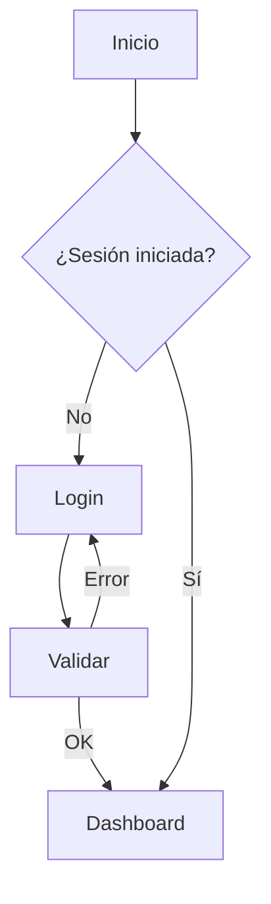

# Interaction Design (IxD)

Define **cómo actúa y reacciona** la interfaz frente al usuario, con claridad,
consistencia y previsibilidad. Diseña el comportamiento, no solo la apariencia.

## 1. Modelos de interacción y flujos

- **Modelo de interacción**: cómo el usuario manipula el sistema (directo,
  conversacional, por comandos, por gestos). Elige según contexto y plataforma.
- **User flow**: camino de extremo a extremo para lograr un objetivo (incluye
  decisiones, ramas y estados).
- **Task flow**: secuencia lineal de una tarea concreta.
- **Wire flow**: combina wireframes + flechas de flujo para mostrar transiciones.
- Diseña el **happy path** y también los caminos alternos y de error.

Ejemplo de flujo en Mermaid:

## 2. Las 5 dimensiones de IxD (Gillian Crampton Smith / Kevin Silver)

Palabras, objetos visuales, espacio, tiempo y comportamiento. Diséñalas juntas:
el comportamiento (cómo responde en el tiempo) es lo que distingue IxD de UI
estática.

## 3. Affordances y significantes (Norman)

- **Affordance**: lo que un objeto permite hacer. **Significante (signifier)**:
  la pista visual que comunica esa posibilidad (un botón parece pulsable).
- **Mapeo**: relación natural entre control y efecto (orden de controles =
  orden de elementos controlados).
- **Restricciones (constraints)**: limita acciones para prevenir errores
  (deshabilitar, ocultar, validar entrada).
- **Feedback**: toda acción produce una respuesta perceptible e inmediata.

## 4. Estados (diseña TODOS, no solo el feliz)

Para cada componente y vista define:
- **Vacío** (empty state): primer uso o sin datos, con guía y acción.
- **Cargando**: skeleton/spinner según duración (skeleton si >1s).
- **Parcial**: carga incremental, paginación, scroll infinito.
- **Error**: mensaje claro + causa + ruta de recuperación.
- **Lleno**: contenido normal.
- **Éxito**: confirmación visible de que la acción funcionó.
- **Sin permiso / no disponible**: explica por qué, no ocultes en silencio.
- Estados de control: default, hover, focus, active/pressed, selected, disabled,
  loading, error, read-only.

## 5. Feedback y respuesta del sistema (Doherty threshold)

- Respuesta visible al input en **<100 ms**; si la operación tarda más, muestra
  progreso. Mantén la conversación fluida (Doherty: <400 ms mantiene el ritmo).
- Tipos de feedback: visual (estado, color, animación), textual (mensajes),
  háptico (móvil), sonoro (úsalo con mesura y nunca como único canal).
- Comunica el estado del sistema siempre (heurística #1 de Nielsen).

## 6. Microinteracciones

Estructura (Dan Saffer): **trigger → reglas → feedback → loops/modos**. Una
buena microinteracción confirma, orienta, deleita sin estorbar y refuerza la
marca. Ejemplos: pull-to-refresh, toggle con transición, validación inline,
"me gusta" animado. Regla: significado sobre decoración; respeta
`prefers-reduced-motion`.

## 6 bis. Diseño emocional y conductual (con ética)

La interacción no solo funciona: **se siente**. Diseña el nivel emocional con
intención, y el conductual con responsabilidad.

- **Tres niveles de Norman**: **visceral** (primera impresión, estética, reacción
  inmediata), **conductual** (usabilidad, feedback, sensación de control durante
  el uso) y **reflexivo** (significado, orgullo, historia que el usuario se
  cuenta después). Una gran experiencia atiende los tres, no solo el conductual.
- **Aesthetic-usability effect**: lo bello se percibe como más usable y genera
  tolerancia a fallos menores — úsalo para reforzar confianza, nunca para tapar
  fricción real.
- **Diseño conductual con contrapeso ético**: modelos como **Fogg (B=MAP:**
  motivación + habilidad + prompt**)** o **Hook (Eyal)** son potentes para formar
  hábitos; úsalos solo para hábitos **valiosos y consentidos**, jamás para
  compulsión, retención por atrapamiento o explotación de sesgos. Todo patrón
  persuasivo pasa por el filtro de **diseño honesto** (ver
  [etica-y-patrones-enganosos.md](etica-y-patrones-enganosos.md)): si manipula o
  no sobreviviría a la transparencia, se descarta.
- **Momentos que importan (peak-end)**: cuida los picos emocionales y el cierre
  del flujo (ver [service-design-mapping.md](service-design-mapping.md)).

## 7. Prevención y recuperación de errores

- **Prevención** (mejor que corrección): restricciones, valores por defecto
  sensatos, confirmación de acciones destructivas, formato guiado de entrada,
  deshabilitar acciones inválidas.
- **Recuperación**: mensajes que explican causa y solución; permite deshacer
  (undo) en vez de confirmar todo; preserva el trabajo del usuario; nunca
  culpes al usuario.
- **Tolerancia**: acepta variaciones de input (mayúsculas, espacios, formatos).

## 8. Divulgación progresiva (progressive disclosure)

Muestra lo esencial primero; revela complejidad bajo demanda. Reduce carga
cognitiva (Hick/Miller) sin esconder funciones críticas. Patrones: acordeones,
"ver más", asistentes por pasos, ajustes avanzados colapsados, defaults +
overrides.

## 9. Focus, teclado y entrada

- **Orden de foco** lógico que sigue el orden visual; foco visible siempre.
- Soporte completo de teclado; atajos para usuarios avanzados sin romper
  accesibilidad (ver [accesibilidad.md](accesibilidad.md)).
- **Input behavior**: tipos de teclado semánticos en móvil (email, tel,
  number), máscaras, autocompletado, autosave en formularios largos.
- **Gestión de foco** tras acciones: al abrir modal, foco al primer elemento;
  al cerrar, devolver foco al disparador; tras error, foco al primer campo
  inválido.

## 10. Interacción responsive y cross-device

- Diseña la **lógica de interacción** por capacidad de entrada (mouse, touch,
  teclado, voz), no solo por tamaño.
- Touch: objetivos ≥44×44 pt (iOS) / 48×48 dp (Android); no dependas solo de
  hover; respeta gestos del sistema.
- Continuidad cross-device: estado y progreso que persisten entre dispositivos
  cuando el journey lo requiere.

## 11. Patrones de interacción (usar con criterio)

Formularios, búsqueda/filtrado, selección, navegación, modales/sheets, drag &
drop, undo/redo, inline edit, bulk actions, notificaciones/toasts, onboarding,
paginación vs scroll infinito. Cada patrón resuelve un problema concreto: no lo
uses por moda. Documenta cuándo SÍ y cuándo NO aplicarlo.

> Regla: la interacción debe ser **previsible**. La sorpresa es buena en el
> deleite, nunca en el comportamiento del sistema.
