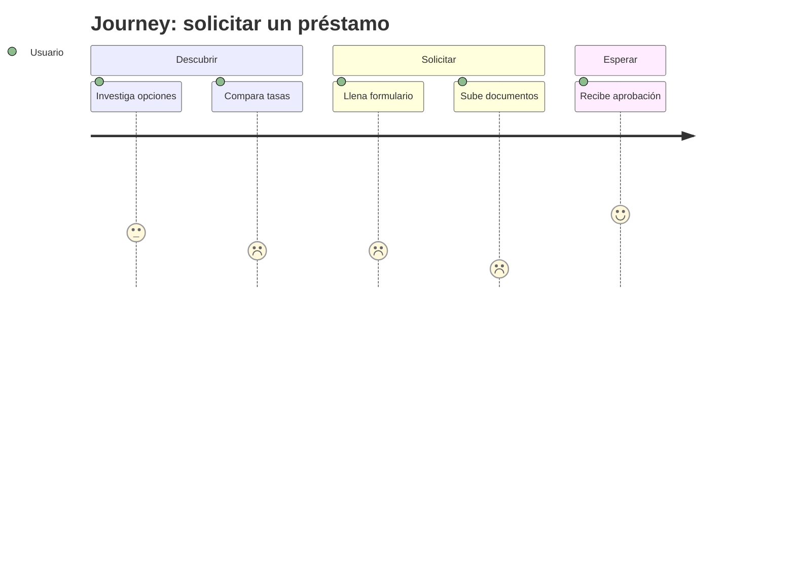

# Service Design y Experience Mapping

La experiencia no es solo pantalla: es el sistema de interacción entre usuario,
servicio y contexto a lo largo del tiempo y de múltiples puntos de contacto.

## 1. Cuándo mapear

Cuando la experiencia abarca varios pasos, canales o actores; cuando hay
fricción entre etapas; cuando lo digital depende de procesos humanos/backstage;
cuando necesitas alinear equipos en torno a una visión común del usuario.

## 2. Tipos de mapas (elige según el objetivo)

- **Empathy map**: qué dice, piensa, hace y siente un usuario. Rápido para
  generar empatía y alinear supuestos.
- **Customer/User Journey Map**: la experiencia de UNA persona hacia UN objetivo
  a través de fases, con acciones, pensamientos, emociones, puntos de contacto,
  dolores y oportunidades. El más usado para diagnóstico.
- **Experience Map**: más amplio y agnóstico de producto; el comportamiento
  humano general en un dominio (útil en greenfield).
- **Service Blueprint**: extiende el journey con las capas **backstage**:
  acciones de empleados (frontstage/visible), procesos de soporte (backstage),
  sistemas y políticas. Revela dónde la operación rompe la experiencia.

## 3. Anatomía de un Journey Map

Filas típicas: **fases** → acciones del usuario → pensamientos → **curva
emocional** → puntos de contacto/canales → dolores → oportunidades → métricas.
Incluye una persona y un escenario concretos. Basa el mapa en evidencia (ver
[research-ux.md](research-ux.md)), no en suposiciones de sala.

## 4. Anatomía de un Service Blueprint

Capas (de arriba a abajo): evidencia física / acciones del usuario / **línea de
interacción** / frontstage (lo visible) / **línea de visibilidad** / backstage
(lo no visible) / **línea de interacción interna** / procesos de soporte y
sistemas. Las "líneas" muestran dónde cruza la información y dónde se rompe.

## 5. Momentos clave

- **Touchpoints** y **canales**: cada punto donde el usuario interactúa (web,
  app, email, call center, físico, notificación).
- **Moments of truth**: momentos críticos que definen la percepción
  (onboarding, primer valor, error, soporte, churn).
- **Peak-end rule**: la gente recuerda el pico (mejor/peor) y el final; diseña
  esos momentos con especial cuidado.
- **Pain points** y **gaps**: prioriza por frecuencia × severidad × impacto.

## 6. Omnicanal y continuidad

- **Channel continuity**: el usuario retoma su tarea entre canales sin reempezar
  (estado y contexto persistentes).
- **Coherencia multi-touchpoint**: marca, contenido y patrones consistentes
  entre canales, respetando las capacidades de cada uno.
- **Ecosystem thinking**: cómo encaja el producto en el conjunto de servicios y
  dispositivos del usuario.

## 7. De mapa a acción

Un mapa sin decisiones es decoración. Cada dolor → oportunidad → hipótesis de
mejora → iniciativa priorizada (ver [estrategia-ux.md](estrategia-ux.md)) →
métrica. Conecta el journey con flujos concretos (ver
[interaccion-disenio.md](interaccion-disenio.md)) y con la IA (ver
[arquitectura-informacion.md](arquitectura-informacion.md)).

## 8. Entregables

- Empathy map / persona basada en evidencia.
- Journey map (as-is y to-be) con curva emocional y oportunidades.
- Service blueprint con capas backstage para experiencias dependientes de
  operación.
- Matriz de touchpoints/canales.
- Backlog de oportunidades priorizadas derivado del mapa.

> Mapea para decidir, no para decorar. El valor del mapa está en las
> oportunidades priorizadas que produce.
